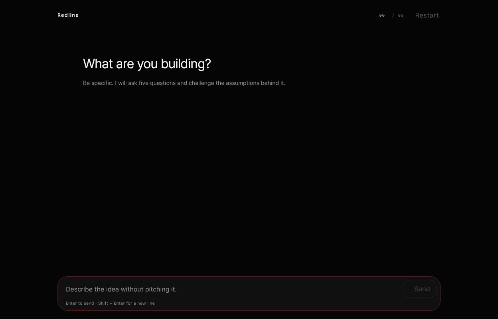
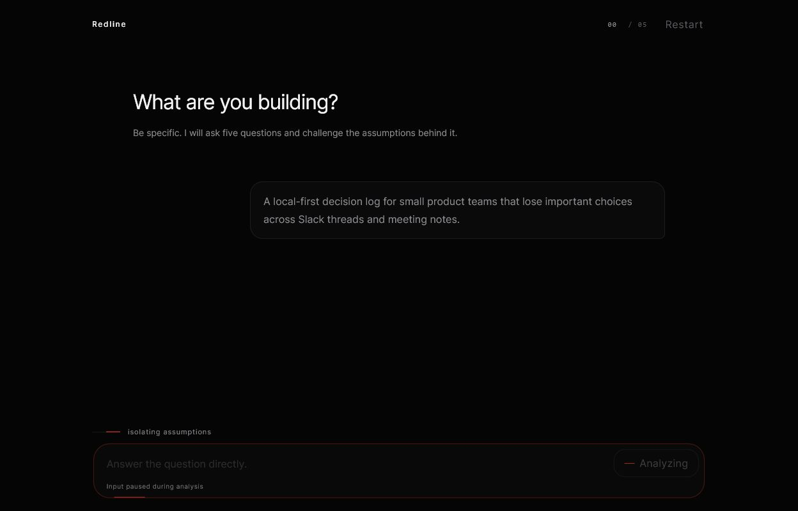

<div align="center">

# Redline

**Pressure-test the idea before you spend months building it.**

Redline runs a focused five-question interrogation, separates evidence from assumptions, and returns an evidence-linked verdict without fake market research or empty encouragement.


</div>



## Why Redline exists

Early product ideas often arrive as polished feature lists before the underlying problem, user behavior, distribution path, or evidence has been tested. Redline slows that reflex down.

It asks exactly five adaptive questions, one at a time:

```text
Idea -> problem reality -> specific user -> current behavior -> distribution commitment -> fatal assumption -> verdict
```

The final report stays on the same conversation surface and ties its claims back to the user's own answers.

## What it does

- Opens directly into one focused chat experience
- Asks exactly five primary questions after the initial idea
- Adapts each question to the conversation so far
- Challenges vagueness, feature-first answers, contradictions, and unsupported claims
- Separates facts, claims, assumptions, and unknowns
- Matches the user's conversation language, including Turkish and English
- Produces a structured verdict with scored dimensions, critical risks, evidence, and a validation order
- Exports the public verdict as clean Markdown
- Persists only the current session in `localStorage`
- Supports keyboard navigation, reduced motion, interruption, retry, and deliberate restart

## Product principles

- **Evidence over confidence.** The interface never treats a claim as proof.
- **Five questions, no escape hatch.** Vague answers lower confidence; they do not create an endless interview.
- **Severe, not abusive.** Redline attacks assumptions and decisions, never the user's intelligence or character.
- **No invented research.** It does not browse the web, fabricate market data, or imply external validation.
- **One excellent surface.** No landing page, account, dashboard, database, analytics, payment flow, or theme system.
- **Motion with purpose.** Every transition communicates state, continuity, or reading rhythm.

## Interface



The canvas is deliberately black, with white editorial typography and signal red reserved for active intelligence, processing, contradiction, risk, verdict, and destructive confirmation. AI responses use capped word-reveal timing, while completed messages never replay after a render or refresh.

## Stack

| Layer | Technology |
|---|---|
| Application | Next.js 16 App Router, React 19, strict TypeScript |
| Styling | Tailwind CSS 4 |
| Motion | Motion for React |
| AI | AI SDK with the Groq provider |
| Models | Environment-configured Groq chat and verdict models |
| Validation | Zod at API, model, evidence, and storage boundaries |
| Persistence | Browser `localStorage` for one current session |
| Quality | Node test runner, ESLint, TypeScript, GitHub Actions |

## Quick start

Requirements:

- Node.js 22 or newer
- npm
- A Groq API key

```bash
npm install
cp .env.example .env.local
npm run dev
```

Windows PowerShell:

```powershell
npm install
Copy-Item .env.example .env.local
npm.cmd run dev
```

Add your key to `.env.local`, then open [http://localhost:3000](http://localhost:3000).

## Environment variables

Never commit `.env.local`, paste secrets into issues, or expose a Groq key through a `NEXT_PUBLIC_` variable.

| Variable | Required | Purpose |
|---|---:|---|
| `GROQ_API_KEY` | Yes | Server-only Groq credential |
| `GROQ_CHAT_MODEL` | No | Interrogation model; defaults to `openai/gpt-oss-20b` |
| `GROQ_FINAL_MODEL` | No | Verdict model; defaults to `openai/gpt-oss-120b` |

The browser never calls Groq directly. Model access lives in server route handlers and `src/lib/ai`.

## Architecture

```text
Browser
  `- explicit conversation state machine
       |- one versioned local session
       |- POST /api/interrogate
       |    |- validate and sanitize the conversation
       |    |- build protected, language-aware prompts
       |    |- request JSON from the configured Groq model
       |    `- parse and validate locally with Zod
       `- POST /api/verdict
            |- enforce the exact five-question sequence
            |- validate evidence references and quotes
            |- generate the structured verdict
            `- reveal it inside the existing chat surface
```

Provider-generated JSON is treated as untrusted text. Redline extracts a single JSON object, validates the complete local schema and evidence graph, and attempts one constrained repair. It never invents a silent fallback analysis.

## Commands

```bash
npm run dev        # Start the development server
npm run lint       # Run ESLint
npm run typecheck  # Run strict TypeScript checks
npm test           # Run the automated test suite
npm run build      # Create a production build
npm start          # Serve the production build
```

## Security and privacy

- `GROQ_API_KEY` is read only in server code.
- Full conversations are not logged by production code.
- User text is isolated as untrusted prompt data.
- API payloads, model output, evidence, and stored sessions are schema-validated.
- Session data stays in the browser unless it is submitted to the local server for the configured Groq request.
- There is no database, authentication layer, analytics collector, web search, or deployment configuration.

See [SECURITY.md](SECURITY.md) for private vulnerability reporting and credential-response guidance.

## Repository structure

```text
src/app/                 App Router page, layout, and API routes
src/components/chat/     Conversation, message, input, and progress UI
src/components/motion/   Word reveal, layout continuity, and scroll controls
src/components/verdict/  Evidence-linked verdict presentation
src/hooks/               State-machine and auto-scroll orchestration
src/lib/ai/              Prompts, Groq access, JSON validation, and errors
src/lib/schemas/         API, conversation, verdict, and storage contracts
src/lib/state/           Explicit reducer and local-session persistence
tests/                   State, AI, verdict, motion, hydration, and security tests
docs/                    Product, design, motion, AI, architecture, and QA specs
```

Start with [docs/00_INDEX.md](docs/00_INDEX.md) for the complete product documentation.

## Current limitations

- One local session; no account or cross-device history
- Exactly five interrogation questions
- No web research or external market validation
- Groq availability, model access, quotas, and latency still affect live generation
- No official hosted Redline instance

## Contributing

Focused contributions are welcome. Read [CONTRIBUTING.md](CONTRIBUTING.md), follow the [Code of Conduct](CODE_OF_CONDUCT.md), and use the supplied issue and pull request templates.

Redline intentionally rejects additions that dilute the core interrogation and verdict experience.

## License

Redline is licensed under the [GNU Affero General Public License v3.0 only](LICENSE).

If you modify Redline and make that modified version available to users over a network, the AGPL requires you to offer those users the corresponding source code under the same license. The complete license text controls.

The software license does not grant rights to the Redline name or visual identity. See [TRADEMARKS.md](TRADEMARKS.md).

Copyright (c) 2026 Redline contributors.
